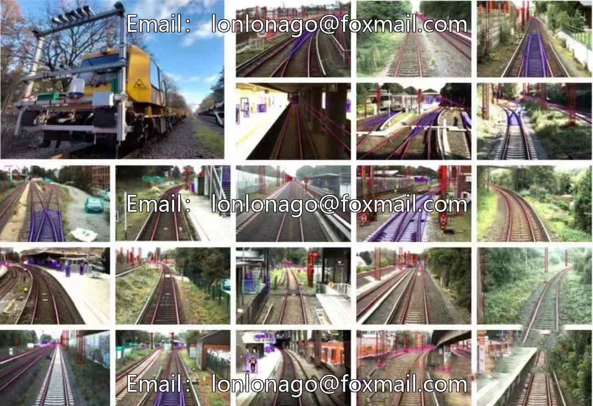
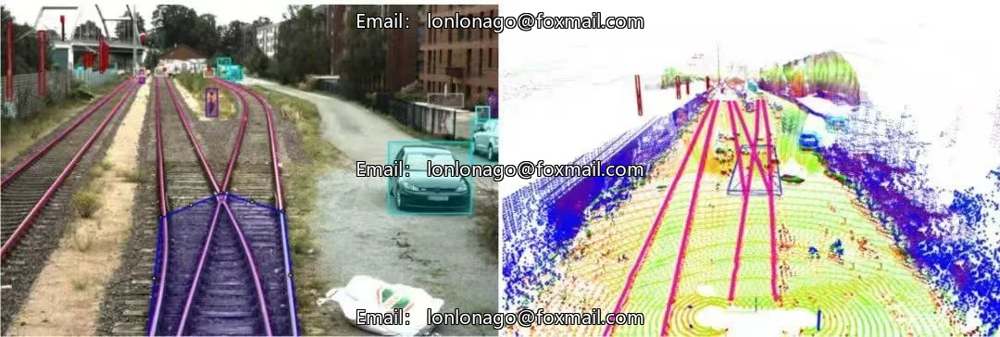

# OSDaR23 Railway Scenario Multi-Sensor Data Track Separation for Smart Railways

## Body

Intelligent Railway Elements Data Set OSDaR23 - Real-world Railway Scenarios, Multi-sensory Data Collection, and Orthogonal Subdivision with Point Cloud Data from Hamburg, Germany
This set of intelligent railway multi-element datasets focuses on real railway operational scenarios, integrating multi-sensor imagery and point cloud data for the task of track segmentation.
The data was collected in Hamburg, Germany, comprising a total of 45 sensor data sequences and 1534 multi-sensor frames, with a dataset size exceeding 45G and containing 204091 finely annotated records.

The dataset consists of a total of 22 categories of labeled targets, covering pedestrians, crowds, trains, bicycles, tracks, signal equipment, flames, smoke, and more. It fully covers four dimensions: personnel, transportation vehicles, railway infrastructure, and environmental anomalies, with well-defined category divisions that can provide ample samples for model training.
It supports multiple mainstream file formats including ZIP, PNG, PCD, CSV, JSON, which are suitable for the implementation of autonomous driving train technology and the research and development of railway target detection algorithms. This aids in the upgrade of operational safety and the construction of intelligent railway industries.
Note: This data set is virtual and once sold, it cannot be returned.
Due to its size, it can be downloaded from  Cloud Disk.
Interested partners can click "I want" to communicate details privately.

## Images

## Payment

Here is a pay link on Stripe ( https://buy.stripe.com/3cs8yP7sY87d0vu9AB ). Please contact me lonlonago@foxmail.com after funding $89, and I will send you a complete data files , thank you!

